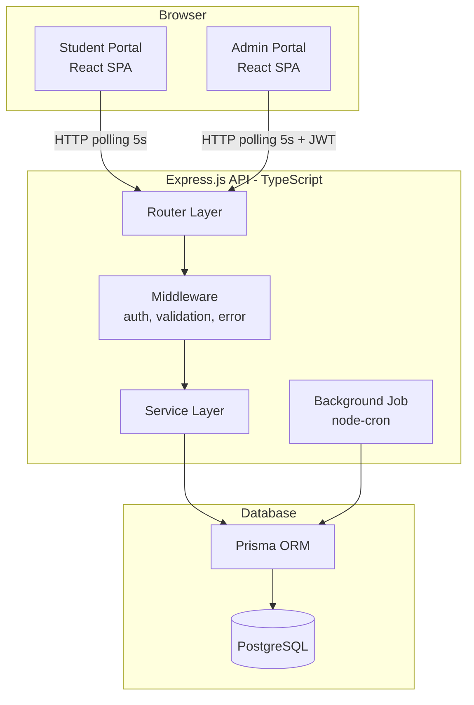
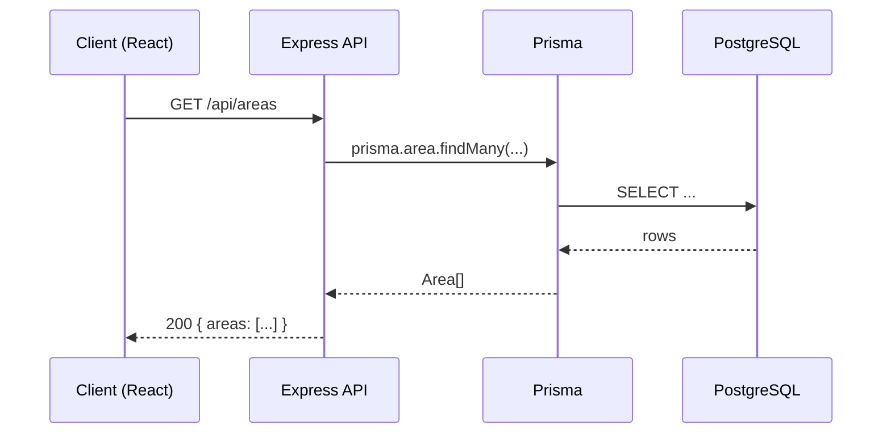
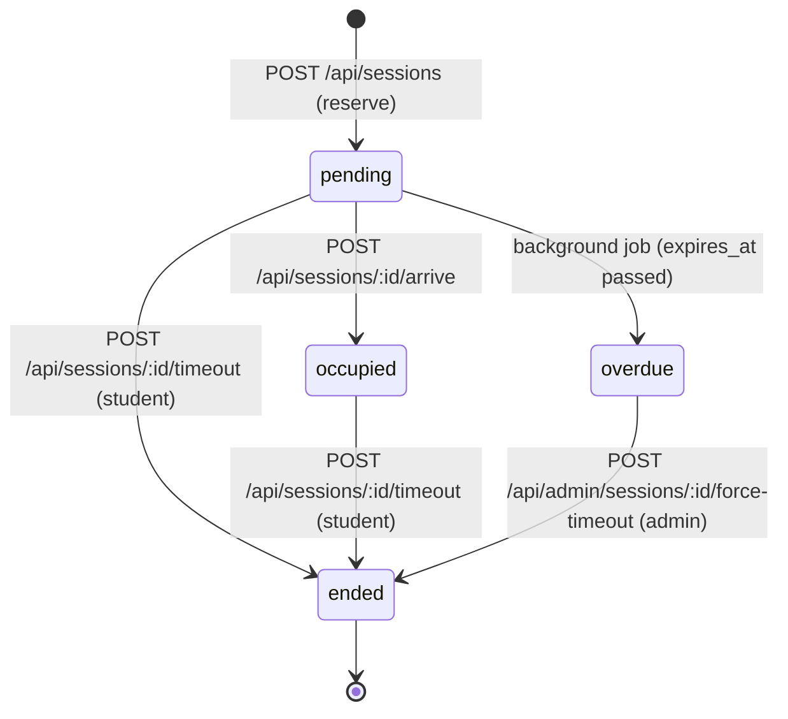

# Design Document

## Overview

SeatSync is a full-stack web application that lets students check real-time seat availability in library and study areas, reserve a specific seat, and manage their active session. Librarians access a separate admin portal with live monitoring and override capabilities.

The system is composed of three layers:

1. **Frontend** – React (Vite) + TypeScript, using shadcn/ui components, Tailwind CSS, React Router v7, and TanStack Query for data fetching and polling.
2. **Backend** – Express.js (TypeScript) REST API with Prisma ORM connected to PostgreSQL.
3. **Database** – PostgreSQL with Prisma-managed migrations and a seed script.

Live updates are implemented via client-side polling at 5-second intervals using TanStack Query's `refetchInterval`. No WebSockets are used in the MVP.

A node-cron background job runs inside the backend process every minute to transition expired `pending` sessions to `overdue`.

---

## Architecture



### Request Flow



### Session State Machine



---

## Components and Interfaces

### Backend Components

#### `src/app.ts` – Express Application Bootstrap
- Registers global middleware (CORS, JSON body parser, request logging)
- Mounts route modules under `/api`
- Registers global error handler
- Starts the node-cron background job

#### `src/routes/` – Route Modules

| File | Prefix | Routes |
|---|---|---|
| `areas.ts` | `/api/areas` | `GET /`, `GET /:id/seats` |
| `students.ts` | `/api/students` | `POST /verify` |
| `sessions.ts` | `/api/sessions` | `POST /`, `POST /:id/arrive`, `POST /:id/timeout`, `GET /active` |
| `admin.ts` | `/api/admin` | `POST /login`, `GET /dashboard`, `GET /sessions`, `POST /sessions/:id/force-timeout` |

#### `src/middleware/`

- **`auth.ts`** – `requireAdmin` middleware: validates Bearer JWT, attaches `req.admin` or returns 401.
- **`validate.ts`** – Request body/query validation using `zod` schemas; returns 400 on failure.
- **`errorHandler.ts`** – Catches all thrown errors; maps known error types to HTTP status codes; logs full errors server-side; returns sanitized JSON to client.

#### `src/services/`

- **`areaService.ts`** – `getAreas()`, `getSeatsForArea(areaId)` – computes `vacantCount` and `occupiedDuration` from live session data.
- **`studentService.ts`** – `verifyStudent(studentNumber)` – looks up by PK, returns student or throws `NotFoundError`.
- **`sessionService.ts`** – `reserveSeat(studentNumber, seatId)`, `arrive(sessionId, studentNumber)`, `studentTimeout(sessionId, studentNumber)`, `getActive(studentNumber)` – all wrapped in Prisma transactions where race conditions are possible.
- **`adminService.ts`** – `login(username, password)`, `getDashboard()`, `getActiveSessions()`, `forceTimeout(sessionId, adminId)`.
- **`backgroundJob.ts`** – node-cron job that runs `markOverdueSessions()` every minute.

#### `src/lib/`

- **`prisma.ts`** – Singleton `PrismaClient` instance.
- **`jwt.ts`** – `signToken(payload)`, `verifyToken(token)` wrappers around `jsonwebtoken`.
- **`errors.ts`** – Custom error classes: `NotFoundError`, `ConflictError`, `ForbiddenError`, `ValidationError`.

### Frontend Components

#### Route Structure (React Router v7)

```
/                           → PublicLiveView (area list + search + polling)
/areas/:areaId              → SeatLayoutView (seat grid + polling)
/verify                     → VerificationFlow (student number input → confirmation)
/session                    → ActiveSessionScreen (pending countdown or occupied timer)
/admin/login                → AdminLogin
/admin/dashboard            → AdminDashboard (seat grid + needs-attention list)
/admin/sessions             → AdminSessionsTable
```

#### Key React Components

| Component | Responsibility |
|---|---|
| `AreaCard` | Displays area name and vacant seat count |
| `AreaSearchBar` | Controlled input; filters AreaCard list client-side |
| `SeatGrid` | Renders CSS grid of `SeatBox` using row/col coordinates |
| `SeatBox` | Color-coded by status; tap reveals duration tooltip |
| `VerificationForm` | Student number input with 5-attempt limit |
| `IdentityConfirmation` | Shows student name + "Is this you?" |
| `ActiveSessionScreen` | Shows status, seat label, countdown or elapsed timer |
| `AdminNeedsAttention` | Lists overdue sessions with student name, seat, elapsed |
| `AdminVacateDialog` | Confirmation dialog before force-timeout |
| `AdminSessionsTable` | Sortable table of all active sessions |

#### TanStack Query Keys

| Key | Description |
|---|---|
| `['areas']` | All active areas; refetches every 5 s |
| `['seats', areaId]` | Seats for a specific area; refetches every 5 s |
| `['activeSession', studentNumber]` | Active session for a student |
| `['adminDashboard']` | Admin dashboard data; refetches every 5 s |
| `['adminSessions']` | Admin sessions table; refetches every 5 s |

#### Auth State (Frontend)

A React Context (`AdminAuthContext`) stores the JWT returned by `POST /api/admin/login`. The token is persisted to `sessionStorage`. An Axios request interceptor attaches the `Authorization: Bearer <token>` header to all requests when the token is present.

---

## Data Models

### Prisma Schema

```prisma
generator client {
  provider = "prisma-client-js"
}

datasource db {
  provider = "postgresql"
  url      = env("DATABASE_URL")
}

model Student {
  student_number String    @id @db.VarChar(11)
  full_name      String    @db.VarChar(200)
  sessions       Session[]
}

model Admin {
  id            Int       @id @default(autoincrement())
  username      String    @unique @db.VarChar(100)
  password_hash String    @db.VarChar(255)
  forced        Session[] @relation("ForcedBy")
}

model Area {
  id          Int     @id @default(autoincrement())
  name        String  @db.VarChar(100)
  description String  @db.Text
  active      Boolean @default(true)
  seats       Seat[]
}

model Seat {
  id        Int       @id @default(autoincrement())
  area_id   Int
  label     String    @db.VarChar(20)
  row       Int
  col       Int
  is_active Boolean   @default(true)
  area      Area      @relation(fields: [area_id], references: [id])
  sessions  Session[]
}

model Session {
  id             Int       @id @default(autoincrement())
  seat_id        Int
  student_number String    @db.VarChar(11)
  status         SessionStatus
  started_at     DateTime  @default(now())
  arrived_at     DateTime?
  expires_at     DateTime
  ended_at       DateTime?
  ended_by       EndedBy?
  admin_id       Int?

  seat           Seat      @relation(fields: [seat_id], references: [id])
  student        Student   @relation(fields: [student_number], references: [student_number])
  admin          Admin?    @relation("ForcedBy", fields: [admin_id], references: [id])
}

enum SessionStatus {
  pending
  occupied
  overdue
  ended
}

enum EndedBy {
  student
  admin
  system
}
```

**Partial Unique Indexes** (added via raw migration SQL):

```sql
-- At most one non-ended session per seat
CREATE UNIQUE INDEX one_active_session_per_seat
  ON sessions (seat_id)
  WHERE status IN ('pending', 'occupied', 'overdue');

-- At most one non-ended session per student
CREATE UNIQUE INDEX one_active_session_per_student
  ON sessions (student_number)
  WHERE status IN ('pending', 'occupied', 'overdue');
```

### API Response Shapes (TypeScript interfaces)

```typescript
// GET /api/areas
interface AreaResponse {
  id: number;
  name: string;
  description: string;
  totalSeats: number;
  vacantSeats: number;
}

// GET /api/areas/:id/seats
interface SeatResponse {
  id: number;
  label: string;
  row: number;
  col: number;
  status: 'vacant' | 'pending' | 'occupied' | 'overdue';
  occupiedDurationSeconds: number | null; // null when not occupied
}

// POST /api/sessions (reserve)
interface ReserveRequest {
  studentNumber: string;
  seatId: number;
}

interface SessionResponse {
  id: number;
  seatId: number;
  seatLabel: string;
  areaName: string;
  studentNumber: string;
  status: 'pending' | 'occupied' | 'overdue';
  startedAt: string;      // ISO 8601
  arrivedAt: string | null;
  expiresAt: string;
}

// GET /api/sessions/active?studentNumber=
interface ActiveSessionResponse {
  session: SessionResponse | null;
}

// POST /api/admin/login
interface AdminLoginRequest {
  username: string;
  password: string;
}
interface AdminLoginResponse {
  token: string; // JWT, 8-hour expiry
}

// Error response (all error routes)
interface ErrorResponse {
  error: string;
  field?: string; // present for validation errors
}
```

---

## Correctness Properties

*A property is a characteristic or behavior that should hold true across all valid executions of a system — essentially, a formal statement about what the system should do. Properties serve as the bridge between human-readable specifications and machine-verifiable correctness guarantees.*

### Property 1: Area response includes accurate vacant count

*For any* set of areas in the database, the vacant seat count returned by `GET /api/areas` for each area SHALL equal the number of seats in that area whose current status is `vacant` (i.e., have no non-ended session).

**Validates: Requirements 1.1**

---

### Property 2: Search filter returns only matching areas

*For any* non-empty search term between 1 and 100 characters, every area returned in the filtered list SHALL have a name that contains the search term (case-insensitive), and no area whose name does not contain the term SHALL appear in the results.

**Validates: Requirements 1.4**

---

### Property 3: Seat status computed correctly from session table

*For any* seat in any area, the status returned by `GET /api/areas/:id/seats` SHALL reflect the current session state: `vacant` if no non-ended session exists, otherwise the status of the single non-ended session (`pending`, `occupied`, or `overdue`).

**Validates: Requirements 2.1**

---

### Property 4: At most one non-ended session per seat

*For any* concurrent or sequential set of reservation requests targeting the same seat, at most one reservation SHALL succeed and all others SHALL be rejected with a 409/400 error, leaving the database with exactly one non-ended session for that seat.

**Validates: Requirements 4.6, 13.2**

---

### Property 5: At most one non-ended session per student

*For any* student, at most one non-ended session SHALL exist in the database at any point in time, such that any reservation request while a non-ended session exists for that student is rejected.

**Validates: Requirements 4.7, 13.3**

---

### Property 6: Pending-to-overdue transition is complete and exclusive

*For any* execution of the background job, every session with status `pending` whose `expires_at` is strictly in the past SHALL be updated to `overdue`, and no session with `expires_at` in the future SHALL be changed.

**Validates: Requirements 8.2**

---

### Property 7: Session status round-trip after arrive

*For any* session in `pending` status, calling `POST /api/sessions/:id/arrive` SHALL transition it to `occupied` and set `arrived_at` to a timestamp within a few seconds of the call, such that querying the session afterwards returns `occupied` with a non-null `arrived_at`.

**Validates: Requirements 5.1**

---

### Property 8: Student timeout releases seat to vacant

*For any* session in `pending` or `occupied` status, calling `POST /api/sessions/:id/timeout` SHALL set `ended_at`, set `ended_by` to `student`, and leave no non-ended session for that seat — making the seat `vacant`.

**Validates: Requirements 6.1**

---

### Property 9: Force-timeout releases seat and records admin identity

*For any* non-ended session, an admin force-timeout SHALL set `ended_at`, set `ended_by` to `admin`, record the acting admin's id in `admin_id`, and leave no non-ended session for that seat.

**Validates: Requirements 11.1**

---

### Property 10: Input validation rejects invalid student numbers

*For any* string submitted as a student number that contains non-numeric characters, is fewer than 7 characters, or exceeds 11 characters, the API SHALL return HTTP 400 with an appropriate error message and SHALL NOT create any session or look up any student.

**Validates: Requirements 3.1, 14.2**

---

## Error Handling

### Error Classification

| Scenario | HTTP Status | Client Message |
|---|---|---|
| Resource not found (area, seat, session, student) | 404 | `"<Resource> not found"` |
| Seat already reserved (conflict) | 409 | `"Seat is no longer available"` |
| Student already has active session | 409 | `"You already have an active reservation"` |
| Session in wrong state for action | 400 | `"Action not valid for current session status"` |
| Invalid student number format | 400 | `"Invalid student number format"` |
| Missing required field | 400 | `"<fieldName> is required"` |
| Wrong credentials (admin login) | 401 | `"Invalid username or password"` |
| Missing/invalid/expired JWT | 401 | `"Unauthorized"` |
| Unexpected server error | 500 | `"An unexpected error occurred"` |

### Error Handling Strategy

1. **Service layer** throws typed custom errors (`NotFoundError`, `ConflictError`, `ValidationError`, `ForbiddenError`).
2. **Route handlers** do not catch errors; they propagate to the global `errorHandler` middleware.
3. **`errorHandler` middleware** maps error class → HTTP status, logs full error (including stack) server-side via `console.error`, and returns a sanitized `{ error: string, field?: string }` JSON body. Stack traces are never sent to the client.
4. **Zod validation middleware** runs before route handlers; on failure it returns 400 immediately with `{ error: string, field: string }`.
5. **Frontend** – TanStack Query's `onError` callbacks surface API error messages in toast notifications or inline field errors (for form submissions). On network failure the last cached data is kept visible.
6. **Background job** – errors during the cron execution are caught, logged with timestamp and count of affected sessions, and the job continues to the next scheduled execution without crashing the process.

---

## Testing Strategy

### Unit Tests (Vitest)

Covers service layer logic in isolation using mocked Prisma:

- `areaService`: vacancy count calculation from various session states
- `sessionService`: reservation conflict detection, state transition guards
- `studentService`: student lookup, attempt-limit logic
- `adminService`: JWT generation/verification, password hashing round-trip
- `backgroundJob`: correct identification of expired pending sessions

### Property-Based Tests (fast-check)

Each property from the Correctness Properties section above maps to a property-based test:

- **Library**: `fast-check` (TypeScript-native, no extra infrastructure)
- **Minimum iterations**: 100 per property
- **Tag format**: `// Feature: seat-check, Property N: <property_text>`

The Prisma client is mocked (using `jest-mock-extended` or `vitest-mock-extended`) so property tests run entirely in-memory at high iteration counts without hitting a database.

| Property | Test focus |
|---|---|
| P1: Vacant count accuracy | Generate areas with varied seat/session sets; verify count |
| P2: Search filter correctness | Generate area lists + search terms; verify inclusion/exclusion |
| P3: Seat status computed correctly | Generate seat + session combinations; verify status mapping |
| P4: One active session per seat | Simulate concurrent reservations; verify exactly one succeeds |
| P5: One active session per student | Same as P4 but keyed by student number |
| P6: Overdue transition completeness | Generate sessions at varied expire times; verify job result |
| P7: Arrive round-trip | Generate pending sessions; call arrive; verify state change |
| P8: Student timeout releases seat | Generate pending/occupied sessions; call timeout; verify vacant |
| P9: Force-timeout records admin | Generate sessions + admin; force-timeout; verify fields set |
| P10: Input validation rejects invalid numbers | Generate invalid student number strings; verify 400 |

### Integration Tests (Vitest + Testcontainers)

Cover the full HTTP stack using a real PostgreSQL instance spun up in Docker:

- Reservation race condition: two simultaneous POSTs to the same seat — exactly one 201, one 409
- Full session lifecycle: reserve → arrive → timeout → verify vacant
- Background job: insert pending sessions with past `expires_at`, run job, verify `overdue`
- Admin login → JWT → protected endpoint access
- Seed script idempotency: run twice, verify row counts

### Frontend Tests (Vitest + React Testing Library)

- `SeatGrid` renders correct number of boxes with correct colors per status
- `AreaSearchBar` filters cards correctly for a range of search terms
- `VerificationForm` disables input after 5 failed attempts
- `ActiveSessionScreen` countdown decrements and disables button at zero
- TanStack Query polling interval is configured to 5 s (verify `refetchInterval`)
